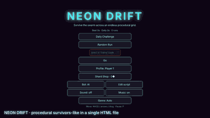

# Neon Drift

***Personal Highscore***: `eyJzIjoiMTc5NDcyMDEwODYyOSIsInQiOjEwNTQsImsiOjQxOTMsImwiOjMzfQ==`

## Gameplay

## Initial Prompt

Create a prompt to one-shot a browser-based (no external dependencies, nothing except for vanilla JS/HTML5/CSS, unless it is a CDN import and justified - ie phaser/ three.js). It should operate entirely on something like GitHub Pages/Netlify. How could we add multiplayer without requiring a backend/install? Should we make a colony simulation or some other genre (like a platformer/shoot-em-up/side-scroller)? It should have gamification/progression/endless playability.

The [final prompt used](PROMPT.md) after some discussion with Claude.

## Response

I'd skip the colony sim for a one-shot. It's the hardest genre to get right in a single pass (pathfinding, job systems, UI density, balance) and the hardest to sync over a peer connection. A top-down co-op survivors-like roguelite (Vampire Survivors / Brotato style) is the better pick:

#### Genre Comparison

| Genre | One-shot odds | Endless replay | Multiplayer difficulty |
|-------|---------------|----------------|------------------------|
| Colony sim | Low | High | Very hard (lots of shared state) |
| Platformer | Medium | Low (finite levels) | Medium |
| Shmup | High | Medium | Easy |
| Survivors-like roguelite | High | Very high | Medium (host-authoritative works well) |

It has simple controls, a built-in difficulty curve, naturally endless runs, and progression hooks (run upgrades plus meta unlocks). It also tolerates imperfect netcode, since mobs are numerous but dumb.

#### Multiplayer without a Backend You Run

There is no true zero-infrastructure option, but these get close:

**1. WebRTC Peer-to-Peer with Serverless Signaling (Best Option)**
- Trystero matches peers through public BitTorrent/Nostr/MQTT relays
- You host and install nothing
- Players share a room code, and one player acts as host
- **Caveats:** It relies on third-party public relays and STUN servers, and strict NATs or corporate networks may fail without a TURN server.

**2. Manual WebRTC Handshake (Most Robust Fallback)**
- Players copy/paste an offer/answer blob or scan a QR code
- It needs no third party
- The UX is clunkier
- Good as a "connection failed" fallback

**3. Async Multiplayer (Zero Networking)**
- Daily seeded runs, plus shareable score or ghost codes (base64 in a URL hash) to compare against friends
- Costs almost nothing and adds real retention

**4. BroadcastChannel**
- Same-browser tabs only
- Useful for local testing, not for real play

I'd combine **1 + 3**: live co-op for 2-4 players, plus a daily-seed challenge with shareable result links.